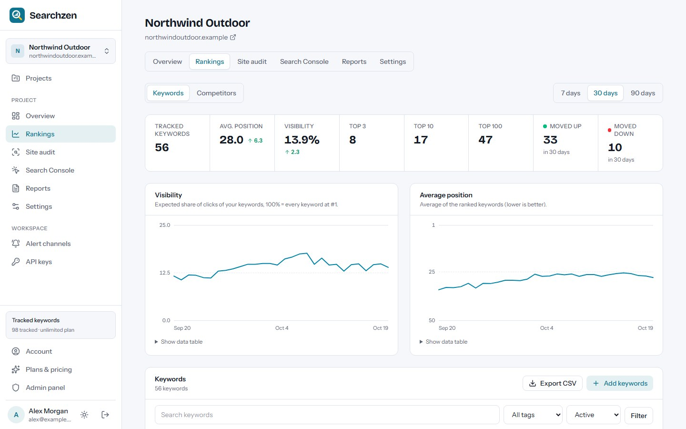
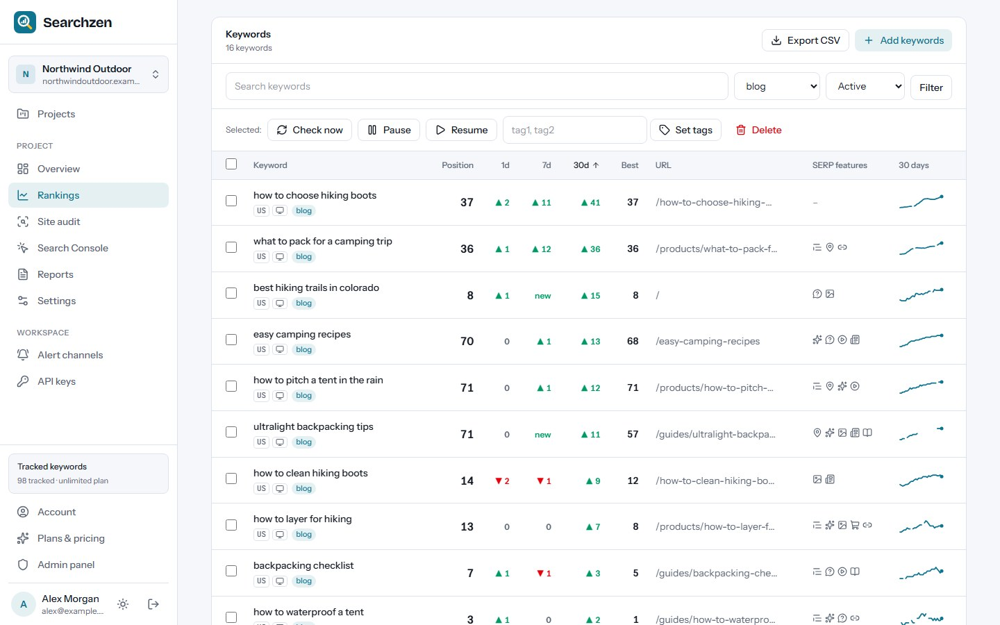
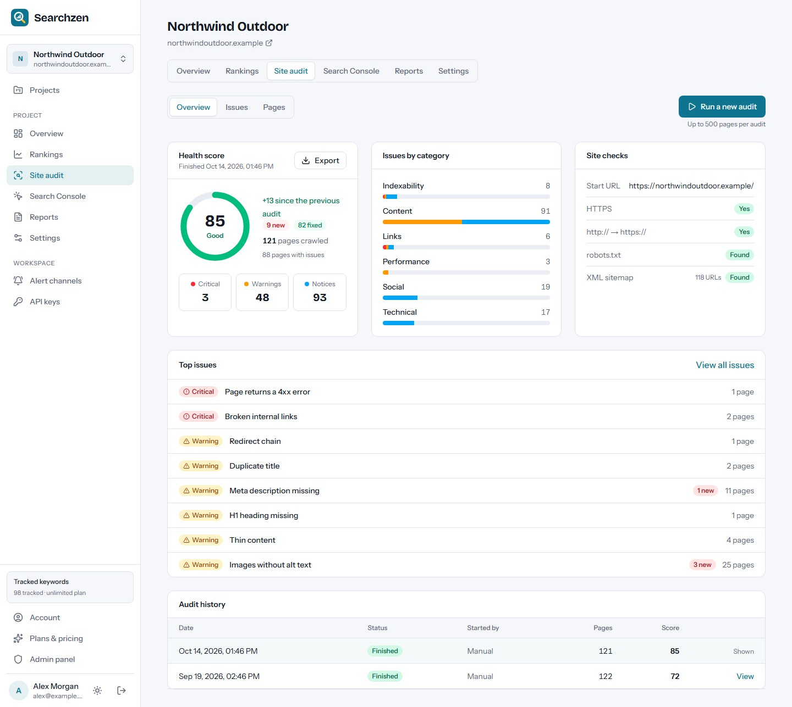
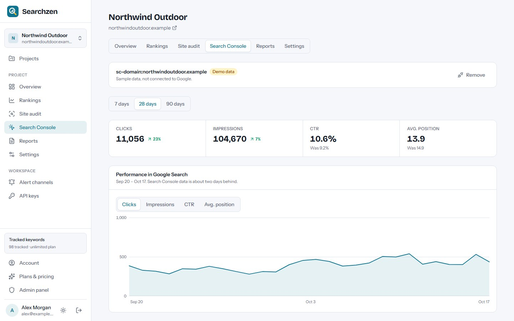
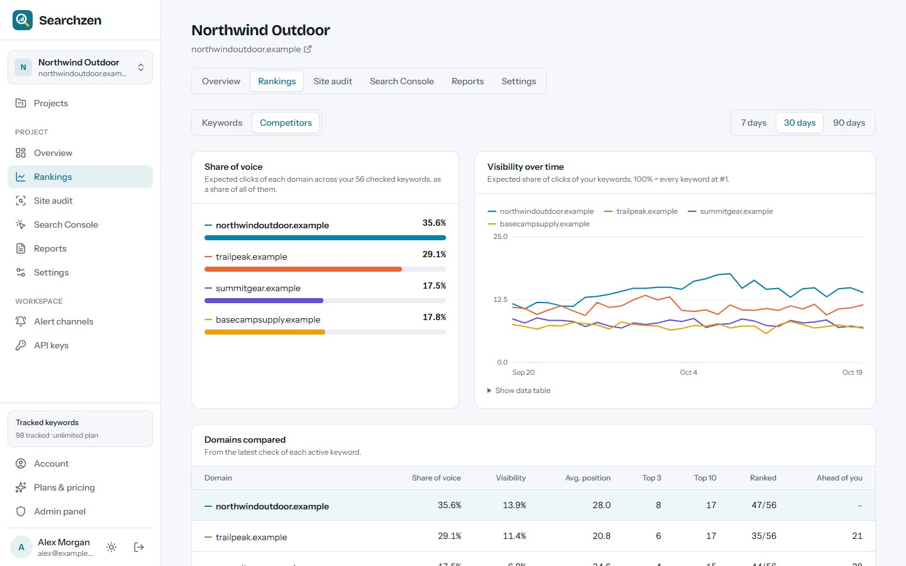
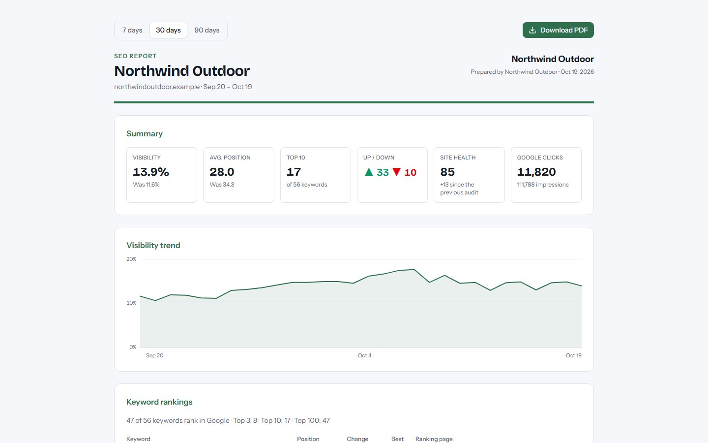
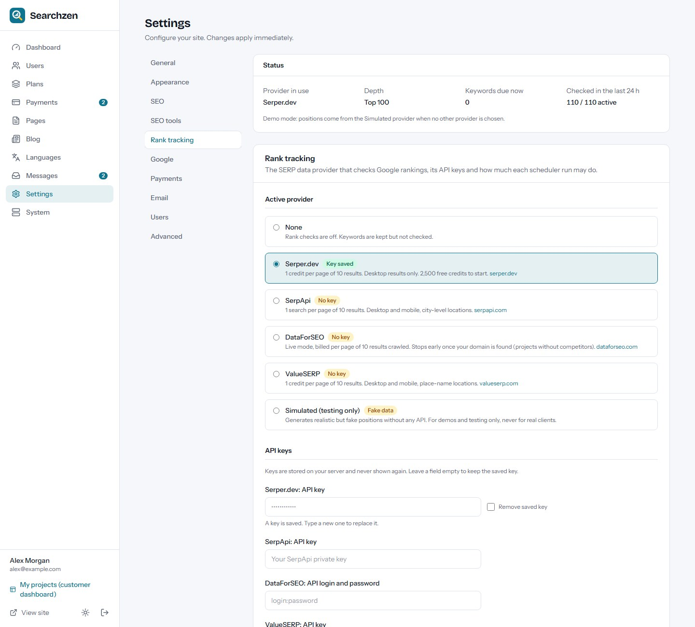

# Searchzen

**Open-source SEO rank tracker, site audit and client reporting — as a self-hosted SaaS.**
Customers track their Google positions, crawl their websites for technical SEO problems, connect
Google Search Console and share white-label reports with their clients. Built with Next.js 16,
React 19 and Tailwind CSS 4. Runs on a VPS, Docker, cPanel (Node.js) or Vercel, with
MySQL/MariaDB or a zero-setup SQLite database.

**Live demo:** https://searchzen-demo.vercel.app — log in with `demo@searchzen.app` / `demo12345`
(data resets regularly; demo rankings come from the built-in Simulated provider).



## Features

- **Rank tracking:** daily or weekly checks per keyword by country, language, city/region and
  device, with tags, target URLs and a depth of 10–100 results. Keywords can be added one by one,
  pasted, imported from CSV or sent through the REST API.
- **SERP providers:** Serper.dev, SerpApi, DataForSEO and ValueSERP (you bring the API key; Google
  is never scraped), plus a Simulated provider for demos and tests.
- **Rank insights:** average position, visibility score, top 3/10/100, movers, position history,
  ranking-URL changes, SERP features, competitors and share of voice, CSV export.
- **Site audit:** a resumable crawler that obeys robots.txt and crawl-delay, reads sitemaps and
  runs 57 checks with a 0–100 health score and new/fixed issues since the previous audit.
- **Google Search Console:** read-only OAuth import of clicks, impressions, CTR, position, top
  queries and pages.
- **Client reports:** share links with an optional password, print-to-PDF layout, weekly or
  monthly report emails, white-label logo, colour and company name, and an embeddable SEO health
  badge.
- **Alerts:** rank and audit alerts by email, Slack, Discord, Microsoft Teams, Telegram or signed
  webhooks, plus a weekly digest.
- **SaaS ready:** customer accounts, plans with project/keyword/frequency/audit limits, Stripe /
  PayPal / Razorpay / bank transfer payments, REST API keys, a blog and a full admin panel.
- **Multi-language** with right-to-left support (Arabic and Hindi packs included).
- **Web installer** — no command line needed on shared hosting.

| Keywords | Site audit | Search Console |
| --- | --- | --- |
|  |  |  |
| **Competitors** | **Client report** | **Admin: SERP providers** |
|  |  |  |

More screenshots are in [`marketing/final/screenshots`](marketing/final/screenshots).

## Hosted version & paid installation

Need Searchzen hosted for you, installed on your own server, or customised? Contact
**[EpiFive](https://www.epifive.com/services#custom-app-development)**.

- Step-by-step guide: [Searchzen on the EpiFive blog](https://www.epifive.com/blog/searchzen-self-hosted-seo-rank-tracker)
- More open-source projects: [epifive.com/open-source](https://www.epifive.com/open-source)

## Quick start

```bash
git clone https://github.com/epifive/searchzen.git
cd searchzen/app
npm install
npm run dev
```

Open http://localhost:3000 — you are redirected to the web installer at `/install`. Choose
**SQLite** for a zero-setup local database, or **MySQL/MariaDB** for production. Then pick a SERP
provider in Admin → Settings → Rank tracking (without one, no rankings are checked).

Production, Docker, PM2, cPanel and Vercel setups, background jobs (lazy mode, cron URL or worker),
SERP provider costs, Google Search Console setup and every setting are covered in
[`app/README.md`](app/README.md) and the full guide in
[`documentation/index.html`](documentation/index.html) (open it in a browser).

**Requirements:** Node.js 20.9+ (22.13+ for SQLite), MySQL 5.7+ / MariaDB 10.3+ or SQLite, an
account with a SERP data provider (paid per request), HTTPS in production (needed for Google
sign-in) and a way to run background jobs (cron URL, worker or lazy mode).

## Repository layout

| Path | What |
| --- | --- |
| `app/` | The Next.js application (dashboard, rank tracker, crawler, reports, admin, installer, worker) |
| `documentation/` | Full user and admin guide (single HTML file) |
| `marketing/` | Screenshot and preview scripts and the final screenshots |

## Contributing

Bug reports and pull requests are welcome — please open an
[issue](https://github.com/epifive/searchzen/issues) first for larger changes. Run
`npm run typecheck`, `npm run lint` and `npm run build` in `app/` before sending a PR.

## License

[MIT](LICENSE) © 2026 EpiFive
